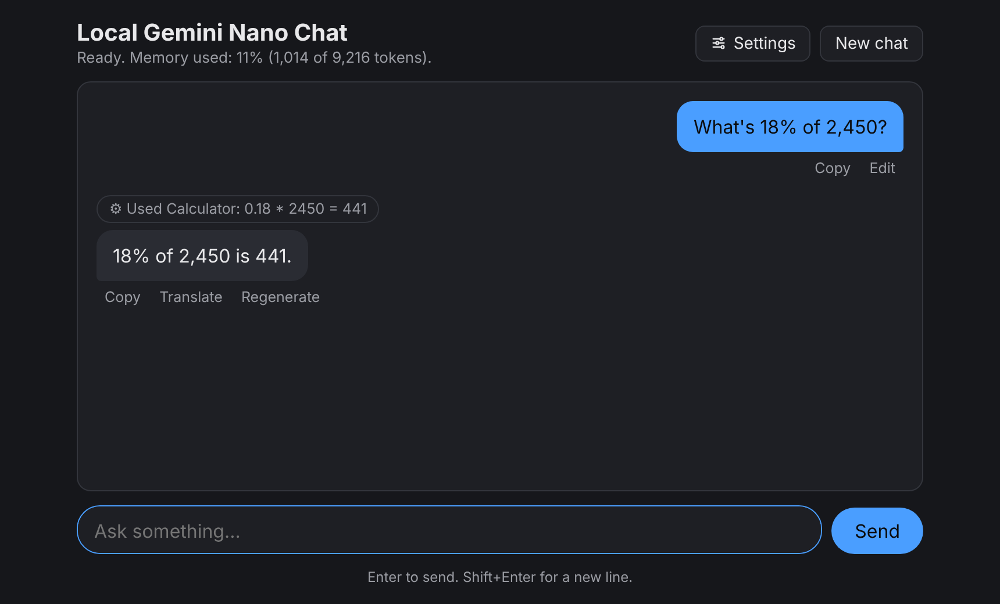

# Local Gemini Nano Chat

A private chat page for the AI model built into your browser: Gemini Nano in Chrome, or Edge's on-device model. It runs on your computer. No API key, no account, no server, no cost per message.

**Try it:** https://semanticentity.github.io/gemini-nano-chat/ (desktop Chrome 148 or later)



## Why on-device

- **Private.** What you type stays on your computer.
- **Free.** No key and no per-message cost.
- **Offline.** Works without internet once the model is downloaded.
- **No backend.** A static page. Nothing to host.

The tradeoff: Gemini Nano is small. It has a 9,216 token context window and is weak at math, dates, and facts. Most of the design below works around that.

## How it works

Plain JavaScript in `index.html` and `tools.js`. No build step, no framework.

### A message, start to finish

1. **Send.** `handleSend()` calls `getSession()` right away, while the click still counts as a user gesture. Chrome needs one to start a model download.
2. **Pick a tool.** A separate model session (the "router") reads the message. Its system prompt is a tool catalog from `catalogPrompt()`, about 380 tokens. It's created once, then `clone()`d per message and destroyed, so routing never uses the chat's memory. It replies in JSON mode: `prompt()` with a `responseConstraint` from `routeSchema()`, where `tool` is an enum of enabled tool names plus `"none"`. If the browser rejects the schema, it asks for plain JSON. Any failure means no tool.
3. **Follow-ups.** The router also sees your previous message, labeled "for context only", so "and in Celsius?" can fill in the place.
4. **Validate and run.** `runTool()` checks arguments with the tool's `validate()`, then runs it. Errors come back as data, never thrown.
5. **Ask before the network.** Tools with a `network` host show an inline box with the exact text and host. Nothing is fetched until you pick Allow once or Always allow. "Always" saves the host. Stop or Don't send cancels with no request.
6. **Answer.** The result is appended to your message as `[Result from the Calculator tool: {...}] Use this result in your answer. Trust it over your own guess.` The chat session writes the reply. If the tool failed or you declined, the model is told that instead.
7. **Show what ran.** A collapsible line like "Used Calculator: 0.18 * 2450 = 441" sits above the reply. Click it for the raw call and result.
8. **Render.** marked parses the Markdown. DOMPurify strips images, iframes, forms, and inline styles, so a reply can't load anything from another site. Code blocks get a Copy button.
9. **Save.** The exchange, including the tool call, goes into local storage.

### The model session

- **System prompt.** A locked part from `identityText()`, then your editable prompt. The locked part says what the model is, that it runs locally with no internet, which units to use, and that each message ends with a time note. Without it, Nano claimed to be Gemma running on Google's servers.
- **Current time.** Each message ends with `(Background note, do not repeat: it is now Sat, Oct 17, 2026, 10:21 AM CDT (America/Chicago).)`. It goes last because small models echo what comes first. `stripEcho()` removes it if repeated, before display, saving, and replay.
- **Creativity fallbacks.** `LanguageModel.create()` is tried with your `samplingMode` and language hints, then `most-predictable`, then without language hints, then bare. Chrome builds with speculative decoding (MTP) only accept `most-predictable`. A toast says when your choice wasn't accepted.
- **Memory after reload.** The last 20 saved messages go back in as `initialPrompts`. On `QuotaExceededError`, it tries 4, then 0. When the chat overflows, Chrome drops the oldest turns and the page says so.
- **Memory meter.** The status bar shows `contextUsage` of `contextWindow`. Settings shows your system prompt's token cost via `measureContextUsage()`.

### Tools

| Tool | What runs | Network |
|---|---|---|
| Calculator | A small expression parser. No `eval`. Handles `% ^ sqrt round` and `2,450` style numbers. | None |
| Days between, Add days | Calendar math in UTC, so daylight saving can't shift a day. | None |
| Time until | Parses "5pm", "17:00", "midnight", or "2026-12-31T23:59" in your time zone. | None |
| Unit converter | Tables for length, weight, volume, speed, area, and temperature. | None |
| Text stats | Counts words, sentences, and characters. | None |
| Wikipedia | MediaWiki API, one request: search plus the top match's intro. | en.wikipedia.org |
| Weather | Open-Meteo geocoding, then a 3 day forecast. "Near me" uses `navigator.geolocation`. | open-meteo.com |

Both web APIs are free, keyless, and allow browser requests. Web tools drop out of the catalog when `navigator.onLine` is false. Turning a tool off in Settings removes it from the catalog and schema.

### Text tools

Summarize, Proofread, and Translate appear under long pasted messages and replies. Each uses the browser's dedicated API when `availability()` says it can run, and a one-off Nano session otherwise.

- **Summarize:** Chrome's Summarizer (`key-points`, markdown).
- **Proofread:** Chrome's Proofreader. It's in an origin trial, so this usually falls back to Nano.
- **Translate:** LanguageDetector finds the source, Translator does the rest. About 40 target languages. Without Translator, Nano covers the languages it supports.

Results are labeled with their source, like "Summary (Chrome Summarizer)", and saved with a `noContext` flag so they never go back into the chat model.

### Setup checks

On load:

1. In an iframe? Browsers block the API there, so it offers a new tab.
2. No `LanguageModel`? It reads browser and version from `navigator.userAgentData` (or the user agent) and shows the fix: update Chrome, turn on two flags, use Edge Canary with its flag, or use a computer.
3. `availability()` runs twice, with and without `samplingMode`, with an 8 second timeout. The best answer wins.
4. `available` loads the model in the background. `downloadable` shows a Download button and disk space needed. `downloading` shows progress. `unavailable` shows hardware requirements and a link to the internals page.

### Storage

`localStorage`, namespaced because all github.io pages share one origin:

- `gemini-nano-chat:history:v1`: the last 100 messages.
- `gemini-nano-chat:settings:v2`: saved prompts, reply format and schema, creativity, language, units, tools.

## Privacy

- The AI runs on your device. Messages never go to a server.
- Web tools send only what the approval box shows, and only after you allow it.
- The page loads marked and DOMPurify from jsDelivr, pinned with integrity hashes.
- Chats and settings live in your browser's local storage only.

## Browser support

| Browser | Status | Needs |
|---|---|---|
| Chrome 148+ desktop (Windows 10 or 11, macOS 13+, Linux, Chromebook Plus) | Works by default | 22 GB free disk. A GPU with more than 4 GB of VRAM, or 16 GB of RAM and 4 CPU cores. |
| Edge Canary or Dev 138+ (Windows 10 or 11, macOS 13.3+) | Works with the "Prompt API for on-device language model" flag | 20 GB free disk. A GPU with 5.5 GB of VRAM. |
| Older Chrome, Firefox, Safari | Not supported | The page says what's missing. |
| Phones and tablets | Not supported | See below. |

The model downloads once (a few GB), then runs offline. The page checks for the `LanguageModel` API, not the browser name, so any browser that adds it will work.

### Phones

This doesn't currently work on phones. Chrome's built-in AI APIs aren't supported yet on Android, iOS, or Chromebooks that aren't Chromebook Plus. Android phones run Gemini Nano for apps through AICore, but Chrome doesn't expose it to web pages. On a phone, the page says so.

Ways it could work later:

- **Chrome ships the API on Android.** No changes needed here.
- **Bundle a model.** WebLLM or Transformers.js can run small models over WebGPU. That means a large download per device and slower replies. A different project.

## Results from a real run

The [tool test page](https://semanticentity.github.io/gemini-nano-chat/eval.html) asks the model 21 questions, runs the tools it picks, and checks the answers. One run on Chrome 155 (macOS):

- Right tool 19 of 21 times.
- Checkable answers: 11 of 13 right with tools, 8 of 13 without.
- Without tools, it got 1234 × 5678 wrong, said 45 days after November 20 is December 5 (it's January 4), and missed the weekday 100 days out.

Use **Copy report** to share your own results.

## Run it locally

```
python3 -m http.server 8000
```

Open http://localhost:8000/ in Chrome as the top-level page. The API is blocked in iframes like CodePen, and `file://` won't load `tools.js` as a module.

## Files

| File | What it is |
|---|---|
| `index.html` | The chat page. Markup, styles, and script. |
| `tools.js` | The tools, router catalog, and JSON schema. Shared with the test page. |
| `eval.html` | The tool test page. |
| `tests/` | Headless tests with the AI faked. See [tests/README.md](tests/README.md). |

## Tests

```
cd tests
npm install
npx playwright install chromium
npm test
```

About 300 checks in under a minute. `LanguageModel`, the other AI APIs, and all network calls are faked, so this tests the page, not the model.

## Troubleshooting

- **Setup card asks for a flag.** Paste the address it shows, set the flag to Enabled, relaunch.
- **Model won't load.** Check `chrome://on-device-internals` (Edge: `edge://on-device-internals`).
- **"Creative" not accepted.** Some Chrome versions only allow Most predictable. The page falls back.
- **Proofread used Gemini Nano.** Chrome's Proofreader is still in an origin trial.
- **"Weather near me" denied.** Allow location in Chrome's site settings.
- **Send does nothing.** The script isn't running. HTML pasted via DevTools "Edit as HTML" never runs scripts.

## Docs

- [The Prompt API, Chrome for Developers](https://developer.chrome.com/docs/ai/prompt-api)
- [Built-in AI APIs, Chrome for Developers](https://developer.chrome.com/docs/ai/built-in-apis)
- [Prompt API in Microsoft Edge](https://learn.microsoft.com/en-us/microsoft-edge/web-platform/prompt-api)

## License

MIT. See [LICENSE](LICENSE).

Built by [@SemanticEntity](https://github.com/semanticentity).
